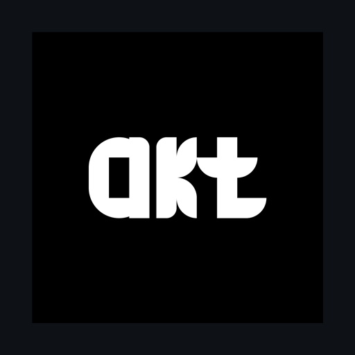

<p align="center">
  
</p>

<h1 align="center">akt</h1>

<p align="center">
  A compiled systems language with C-like syntax, a C11 backend and
  first-class C interop.
</p>

<p align="center">
  <a href="CHANGELOG.md"></a>
  <a href="LICENSE"></a>
  
  <a href="https://t.me/bykvis"></a>
</p>

---

akt compiles `.akt` files to C11 and builds them with Clang or GCC.
It has no garbage collector, no hidden runtime, and no private build
system: the generated C is readable, the build cache is local, and any C
library is one `cinclude` away.

```akt
fn main() int {
    println("Hello, World!")
    return 0
}
```

## Why akt

- **Small and predictable.** One compiler, one build tool, a small C
  runtime. Release binaries are around 10 KB.
- **Real C interop.** Include a header and call C directly; no bindgen
  step, no generated files in your project.
- **Fast.** Within 10–15% of C in the benchmark suite, sometimes faster.
- **Clean projects.** Everything generated goes to `.kache/`; your
  source tree stays yours.
- **Batteries included.** JSON, regex, HTTP, SQLite, threads, atomics,
  HTTP client, file system, UTF-8 strings.

## Installation

### Windows

Download **`akt-1.0.0-setup.exe`** and run it.

The installer checks for Clang and, if it is missing, asks whether to
install LLVM for you. Everything generated by the toolchain lives in
`%LOCALAPPDATA%\akt`.

Silent options:

```powershell
akt-1.0.0-setup.exe --quiet
akt-1.0.0-setup.exe --dry-run
akt-1.0.0-setup.exe --no-llvm --no-path --prefix D:\akt
```

### Linux / macOS

```bash
tar xf akt-1.0.0-src.tar.gz
cd akt-1.0.0-src
sh scripts/install.sh
```

The script checks for Clang and asks before installing it with
`apt`/`dnf`/`pacman`/`brew`. Binaries are installed to `$HOME/.local`.

## Quick start

```bash
katek new hello
cd hello
katek run
```

```text
Hello from akt!
```

## Language

```akt
struct Player {
    f64 x
    f64 y

    fn speed_squared() f64 {
        return self.x * self.x + self.y * self.y
    }
}

enum Shape {
    Circle(f64)
    Rect(f64, f64)
}

fn area(Shape s) f64 {
    switch (s) {
        case Circle(r): return 3.14159 * r * r
        case Rect(w, h): return w * h
    }
    return 0.0
}

fn main() int {
    Player p = Player { x: 3.0, y: 4.0 }
    println(f"speed^2 = {p.speed_squared():.1}")

    Shape s = Shape::Circle(2.0)
    println(f"area = {area(s):.2}")
    return 0
}
```

Supported today:

- local variables at first use, globals without `static`;
- structs, methods, `static fn`, enums with payloads;
- fixed arrays, `Vector`, `Map`, `Set`, `Deque`;
- `Option<T>`, `Result<T, E>`, `?`, `??`;
- `defer`, arenas, `shared`/`weak`, `Mutex`, `Atomic<T>`;
- closures in `filter`/`map`/`reduce` and `thread.spawn`;
- `async`/`await` with `async.all`, `async.select`, `async.timeout`;
- modules (`use a.b`), `type` aliases, f-strings with `{x:.2}`.

## C interop

`cinclude` imports declarations from a header. `cimport` does the same
and also compiles the sibling `.c` file.

```akt
cinclude <string.h>
cimport "libs/sokol/sokol_app.h"

fn main() int {
    println(f"len = {strlen("hello") as int}")
    return 0
}
```

- typedefs, structs, unions, enums, `#define`s and prototypes are
  imported automatically;
- `cfn` / `cstruct` / `cunion` are available as a manual escape hatch;
- header-backed structs get `_Static_assert` size checks.

## Dependencies

Dependencies are declared in `katek.toml` and resolved by `katek`:

```toml
[package]
name = "game"
version = "1.0.0"
edition = "2026"

[native]
link = ["glfw3", "opengl32", "gdi32", "user32", "shell32"]

[native.dependencies]
glfw = { provider = "xrepo", version = "3.4" }
```

```bash
katek c install
katek build
```

Providers: `xrepo`, `vcpkg`, `Conan`, `pkg-config`, `system`, `CMake`,
plus local header/source libraries via `cimport`. No `vendor/` folder
is required.

## Performance

Best of 3 runs on Windows x64: Clang `-O3 -march=native`, Rust `-O`,
Zig `-O ReleaseFast`. Lower is better.

| test | akt | C | C++ | Rust | Zig |
|---|---:|---:|---:|---:|---:|
| fib(32) | 94.2 ms | 84.4 ms | 93.4 ms | 91.1 ms | 92.6 ms |
| loop (100M) | 147.8 ms | 141.0 ms | 145.0 ms | 228.1 ms | 149.0 ms |
| sieve (5M) | 105.1 ms | 98.0 ms | 97.9 ms | 95.9 ms | 110.0 ms |
| matmul (256²) | 81.3 ms | 87.8 ms | 85.0 ms | 80.4 ms | 96.1 ms |
| hash (16 MB) | 135.0 ms | 116.2 ms | 115.9 ms | 132.4 ms | 125.5 ms |

Run it yourself:

```powershell
powershell -ExecutionPolicy Bypass -File benchmarks/run.ps1
```

Full results: [benchmarks/RESULTS.md](benchmarks/RESULTS.md).

## Documentation

| | |
|---|---|
| [Installation](docs/INSTALL.md) | Windows, Linux, macOS, troubleshooting |
| [Getting started](docs/GETTING_STARTED.md) | first project and core syntax |
| [Language reference](docs/LANGUAGE.md) | everything the compiler accepts |
| [Standard library](docs/STDLIB.md) | strings, collections, IO, JSON, regex, HTTP, SQLite, threads |
| [CLI and build tool](docs/CLI.md) | `aktc`, `katek`, project layout, cache |
| [C libraries](docs/C_LIBRARIES.md) | `cinclude`, `cimport`, dependencies |
| [Testing](docs/TESTING.md) | test suites, fuzzing, sanitizers |
| [Architecture](docs/ARCHITECTURE.md) | compiler pipeline and runtime |
| [Android](docs/ANDROID.md) · [JNI](docs/JNI.md) | mobile builds |
| [Roadmap](docs/ROADMAP.md) | status and plans |
| [Русская документация](docs/ru/README.md) | по-русски |

## Project layout

```text
aktc/        compiler: lexer, parser, checker, C11 codegen, C importer
katek/       build tool: projects, dependencies, cache, JNI, export
runtime/     C runtime: strings, vectors, JSON, regex, HTTP, SQLite, threads
std/         standard modules
docs/        English documentation (docs/ru for Russian, docs/design for notes)
examples/    runnable examples, including a 3D game
benchmarks/  comparison suite vs C, C++, Rust and Zig
scripts/     install.sh for Linux/macOS
tests/       language tests, negative tests, fuzz, ASan
```

## Project status and honesty

- **akt is built with heavy use of AI.** The compiler, runtime, tools and
  documentation were written with AI assistance and reviewed by hand.
- **The language is young.** It is a 1.0 release, but expect rough
  edges. Please report bugs, confusing errors and missing features:
  open an issue in the repository.
- **It will get better.** Diagnostics, the header importer, the async
  runtime and the standard library are actively improved.

Known limitations of 1.0:

- no user-defined generics beyond the built-in containers;
- `async` runs on OS threads (no separate executor yet);
- no full borrow checker for `^T`/`weak`;
- the header importer does not parse bitfields or complex declarators;
- no package registry yet (dependencies come from existing providers).

## Contributing

Contributions are welcome. See [CONTRIBUTING.md](CONTRIBUTING.md) and
[docs/TESTING.md](docs/TESTING.md).

## Community

- Telegram: [@bykvis](https://t.me/bykvis)
- Issues: use the repository issue tracker for bugs and feature requests.

## License

akt is licensed under **GPL-3.0-or-later** with the
[akt Output Exception](LICENSE-EXCEPTION):

- **programs you write in akt** — any license, including proprietary and
  closed source;
- **akt itself and its forks** — open source under the GPL.

See [LICENSE](LICENSE) and [LICENSE-EXCEPTION](LICENSE-EXCEPTION).
